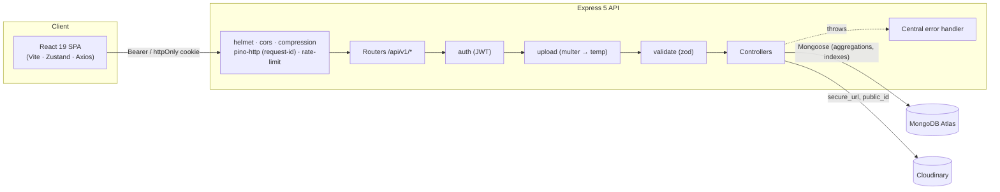
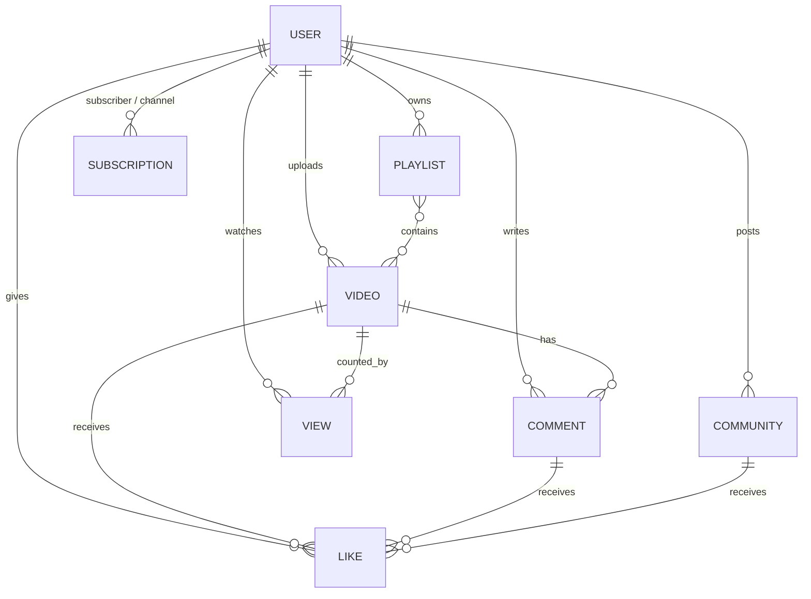

# 🎬 VideoTube

A full-stack, YouTube-style video platform. Creators upload videos, grow a channel and talk to their audience through comments, likes, community posts, playlists and subscriptions — with a creator studio for analytics.

The backend is the core of the project: a **production-style REST API** built with Express 5 and MongoDB. It has layered validation, rotating JWT sessions, rate limiting, structured logging, aggregation-based analytics, OpenAPI docs, Docker and an integration test suite that runs in CI.

**Live demo:** https://video-tube-fawn.vercel.app

[](./.github/workflows/ci.yml)


---

## Contents

- [Highlights](#-highlights)
- [Architecture](#-architecture)
- [Tech stack](#-tech-stack)
- [Backend deep-dive](#-backend-deep-dive)
- [API reference](#-api-reference)
- [Data model](#-data-model)
- [Getting started](#-getting-started)
- [Environment variables](#-environment-variables)
- [Testing & CI](#-testing--ci)
- [Deployment](#-deployment)
- [Project structure](#-project-structure)
- [Roadmap](#-roadmap)

---

## ✨ Highlights

| Backend | Frontend |
| --- | --- |
| Refresh-token **rotation with reuse detection** (hashed tokens at rest) | "Aurora glass" design system (glassmorphism and animated gradients) |
| **Zod** validation on every route: params, query and body | Infinite scroll on every feed |
| **Rate limiting** (global, plus a strict limiter on credential endpoints) | Optimistic likes and subscriptions |
| Ownership checks on every mutation (videos, playlists, comments, posts) | Drag-and-drop uploads with live preview and **upload progress** |
| **Race-safe likes, views and subscriptions** using unique indexes | Creator studio with charts and a content table |
| **Single-query aggregations** with `$facet` pagination | Watch page with "Up next", share and save-to-playlist |
| Cascading deletes and Cloudinary asset cleanup | Fully responsive, keyboard shortcut `/` to search |
| Structured logs (pino), request IDs, graceful shutdown, health check | Lazy-loaded studio bundle |
| OpenAPI 3.1 docs at `/api-docs` | Accessible dialogs (Radix) instead of `window.confirm` |
| 29 integration tests on an in-memory MongoDB, Docker and GitHub Actions | Strict TypeScript, ESLint and Prettier |

---

## 🏗 Architecture



**Request lifecycle**

1. `pino-http` tags every request with an `X-Request-Id`, which is echoed in error bodies so you can find the matching log line.
2. Security middleware runs: helmet headers, a CORS allow-list, body-size limits and rate limiting.
3. The route chain runs: `auth → upload → validate → controller`. Zod parses and coerces the input, and unknown keys are stripped. That stripping is also what blocks NoSQL operator injection (for example `{"username": {"$ne": null}}`).
4. Controllers throw `ApiError`s. One error handler maps Mongoose cast and validation errors, E11000 duplicates, Multer and JSON-parse errors to clean HTTP responses. Stack traces are hidden in production.
5. Temporary upload files are removed after **every** response, success or failure, by a `res.on("finish")` hook.

---

## 🛠 Tech stack

**Backend:** Node.js 20+, Express 5, MongoDB + Mongoose 9, JWT, bcrypt, Zod, Multer, Cloudinary, pino, helmet, express-rate-limit, swagger-ui-express
**Frontend:** React 19, TypeScript, Vite 7, Tailwind CSS v4, Radix UI / shadcn, Zustand, Axios, Recharts, Sonner
**Testing / DevOps:** `node:test`, Supertest, mongodb-memory-server, Docker, docker-compose, GitHub Actions
**Hosting:** Vercel (frontend), Render (API), MongoDB Atlas, Cloudinary

---

## 🔬 Backend deep-dive

### Authentication & sessions
- The **access token** is short-lived and its payload is minimal (`_id`, `username`). It is accepted from the `Authorization: Bearer` header or an httpOnly cookie.
- **Refresh tokens rotate**: every `/refresh-token` call issues a new pair. Only a **SHA-256 hash** of the current refresh token is stored. Each token carries a unique `jti`.
- **Reuse detection**: if someone presents an old token that is still validly signed, the API treats it as possible theft and **revokes the session**.
- **Changing your password** rotates the session and signs out all other devices.
- Login returns **one generic error** for "unknown user" and "wrong password", so attackers can't find out which accounts exist.
- `password` and `refreshToken` are `select: false` in the schema and removed again in `toJSON`. They cannot leak through populate or `$lookup`, because every embedded user goes through a public projection.
- Cookies are set with `httpOnly` and `secure`, plus `sameSite=none` in production so the Vercel frontend and Render API (different sites) still work together.

### Data integrity & concurrency
- **Likes:** a partial unique index on `(likedBy, video | comment | community)` exists. Toggling tries delete-then-insert, and a racing duplicate insert (E11000) counts as "already liked". The denormalised `video.likes` counter only changes when a like was actually created or removed.
- **Views:** each unique `(video, viewer)` pair is stored in a `views` collection with a unique index, using an upsert. The view counter goes up only when the upsert inserted a row, so concurrent requests can't double count. This replaces an unbounded `viewers[]` array that could grow past MongoDB's 16 MB document limit.
- **Watch history** is updated with **one atomic pipeline update**: move to front, de-duplicate, cap at 50.
- **Subscriptions:** a unique `(subscriber, channel)` index, and you can't subscribe to yourself.
- **Playlists:** `$addToSet` / `$pull` make add/remove idempotent. Video order is preserved when reading, because `$lookup` alone does not keep array order.
- **Cascading delete:** removing a video also deletes its comments, likes (including likes on those comments) and views, and removes it from playlists and watch histories. The Cloudinary assets are destroyed too.

### Query design
- Every list endpoint is **paginated** and returns `{ docs, totalDocs, page, limit, totalPages, hasNextPage, ... }`. Pagination uses a single `$facet` aggregation, so the data and the count come back in one round-trip.
- The video detail endpoint returns the owner, their subscriber count, `isSubscribed` and `isLiked` in **one aggregation** instead of four API calls.
- Sorting is restricted to an allow-list. Search input is **regex-escaped** to prevent ReDoS and regex injection.
- Indexes are tuned to the queries: `{isPublished, createdAt}`, `{owner, createdAt}`, `{video, createdAt}` on comments, a text index on title/description, and the unique indexes above.
- **Creator analytics** (`/dashboard/stats`) uses `$facet` to compute totals, top videos and uploads/views per month in a single pass.

### Operations
- **Env validation at boot**: a missing or invalid variable stops startup with a clear message.
- **Structured JSON logs** (pretty-printed in dev). Authorization headers, cookies and passwords are redacted from logs.
- `GET /api/v1/healthcheck` reports DB connectivity, uptime and memory, and returns 503 when the database is down.
- **Graceful shutdown** on `SIGTERM`/`SIGINT`: the server stops accepting connections, finishes in-flight requests and closes the database connection. A 10 s hard timeout applies.
- Uploads are checked by **MIME type per field** and size: 500 MB for video, 10 MB for images. Uploaded files get random names to avoid collisions and path traversal. Videos upload to Cloudinary in chunks.

---

## 📚 API reference

Base URL: `/api/v1`. Interactive docs: **`/api-docs`** (Swagger UI). Raw spec: `/api-docs.json`.

Every response uses this envelope:

```json
{ "statusCode": 200, "success": true, "message": "Videos fetched", "data": { } }
```

Errors add `errors[]` (field-level details) and a `requestId`.

🔒 = requires auth · 👤 = optional auth (personalised when signed in)

| Area | Method & path | Description |
| --- | --- | --- |
| Health | `GET /healthcheck` | Liveness and DB readiness |
| Auth | `POST /users/register` | Multipart: `fullName, email, username, password, avatar, coverImage?` |
| | `POST /users/login` | `{ email \| username, password }` → tokens and cookies |
| | `POST /users/refresh-token` | Rotate tokens |
| | 🔒 `POST /users/logout` | Revoke refresh token |
| | 🔒 `POST /users/change-password` | Signs out other sessions |
| Users | 🔒 `GET /users/current-user` | |
| | 🔒 `PATCH /users/update-account` | `{ fullName?, email? }` |
| | 🔒 `PATCH /users/avatar`, `/users/cover-image` | Old asset is deleted from the CDN |
| | 🔒 `GET / DELETE /users/watch-history` | List / clear |
| | 🔒 `DELETE /users/watch-history/:videoId` | Remove one entry |
| | 👤 `GET /users/c/:username` | Channel profile: subscribers, videos, total views, `isSubscribed` |
| Videos | 👤 `GET /videos` | `page, limit, query, userId, sortBy, sortType` |
| | 🔒 `POST /videos/publish` | Multipart: `title, description, videoFile, thumbnail, isPublished` |
| | 👤 `GET /videos/:id` | Details with `isLiked` and `owner.isSubscribed` |
| | 👤 `GET /videos/:id/related` | "Up next" suggestions |
| | 👤 `PATCH /videos/:id/view` | Unique view and history update |
| | 🔒 `PATCH /videos/:id` · `DELETE /videos/:id` | Owner only |
| | 🔒 `PATCH /videos/:id/toggle-publish` | Owner only |
| Comments | 👤 `GET /comments/:videoId` | Paginated, with `likesCount` and `isLiked` |
| | 🔒 `POST /comments/:videoId` | (legacy: `POST /comments/add/:channelId/:videoId`) |
| | 🔒 `PATCH / DELETE /comments/:commentId` | Owner only |
| Likes | 🔒 `POST /likes/video/:id` · `/likes/comment/:id` · `/likes/community/:id` | Toggle |
| | 🔒 `GET /likes/video/:id` | Like status |
| | 🔒 `GET /likes/videos` | Liked videos (paginated) |
| Playlists | 🔒 `POST /playlists` | Create |
| | 👤 `GET /playlists/:id` · `GET /playlists/user/:userId` | Includes totals (videos, duration, views) |
| | 🔒 `POST /playlists/add/:playlistId/:videoId` | Owner only, idempotent |
| | 🔒 `DELETE /playlists/:playlistId/:videoId` | Owner only |
| | 🔒 `PATCH / DELETE /playlists/:id` | Owner only |
| Subscriptions | 🔒 `POST /subscriptions/:channelId` | Toggle → `{ isSubscribed, subscribersCount }` |
| | 🔒 `GET /subscriptions/user/:userId` | Channels a user follows |
| | 🔒 `GET /subscriptions/channel/:channelId` | Subscribers (paginated) |
| | 🔒 `GET /subscriptions/feed` | Latest videos from followed channels |
| Community | 👤 `GET /community` · `GET /community/:channelId` | Paginated, with likes |
| | 🔒 `POST /community` · `PATCH / DELETE /community/:id` | |
| Dashboard | 🔒 `GET /dashboard/stats` | Views, likes, subscribers (+30-day growth), comments, top videos, monthly series |
| | 🔒 `GET /dashboard/videos` | All own videos including drafts, with comment counts |

---

## 🗄 Data model



---

## 🚀 Getting started

**Prerequisites:** Node.js 20+, a MongoDB instance (Atlas or local) and a Cloudinary account. For local work without Cloudinary you can set `MEDIA_STORAGE=mock`.

```bash
git clone https://github.com/YOUR_USERNAME/VideoTube.git
cd VideoTube
```

### Backend

```bash
cd BackEnd
cp .env.example .env      # fill in MongoDB + Cloudinary + JWT secrets
npm install
npm run dev               # http://localhost:8000  ·  docs at /api-docs
```

Or run MongoDB and the API together with Docker:

```bash
cd BackEnd
docker compose up --build
```

### Frontend

```bash
cd FrontEnd
cp .env.example .env.local   # leave VITE_API_BASE_URL empty to use the dev proxy
npm install
npm run dev                  # http://localhost:8080
```

---

## ⚙️ Environment variables

Backend (`BackEnd/.env`; see `.env.example`):

| Variable | Required | Default | Notes |
| --- | --- | --- | --- |
| `MONGODB_URI` | ✅ | | Connection string |
| `DB_NAME` | | DB from URI | Database name |
| `ACCESS_TOKEN_SECRET` / `REFRESH_TOKEN_SECRET` | ✅ | | At least 16 chars each |
| `ACCESS_TOKEN_EXPIRY` / `REFRESH_TOKEN_EXPIRY` | | `15m` / `10d` | |
| `CORS_ORIGIN` | | `http://localhost:5173,http://localhost:8080` | Comma-separated allow-list |
| `CLOUDINARY_CLOUD_NAME` / `_API_KEY` / `_API_SECRET` | ✅* | | *Not needed when `MEDIA_STORAGE=mock` |
| `MEDIA_STORAGE` | | `cloudinary` | `cloudinary` or `mock` |
| `RATE_LIMIT_MAX` / `AUTH_RATE_LIMIT_MAX` | | `1000` / `20` | Per 15 min, per IP |
| `TRUST_PROXY` | | `1` | Number of proxy hops (Render = 1) |
| `BCRYPT_SALT_ROUNDS`, `LOG_LEVEL`, `API_DOCS_ENABLED`, `PORT` | | | |

Frontend (`FrontEnd/.env.local`):

| Variable | Notes |
| --- | --- |
| `VITE_API_BASE_URL` | API origin without `/api/v1`, e.g. `https://videotube-api.onrender.com`. Leave empty in dev. |
| `VITE_PROXY_TARGET` | Dev proxy target (default `http://localhost:8000`) |

---

## 🧪 Testing & CI

```bash
cd BackEnd
npm test            # 29 integration tests — boots an in-memory MongoDB, no setup needed
npm run format:check
```

The suites cover:

- **Auth:** validation, duplicate detection, generic login errors, NoSQL-injection blocking, refresh rotation and reuse detection, password change, public profile without email.
- **Videos:** pagination and search, safe regex, sort allow-list, owner-only mutations, draft visibility, unique and concurrent views, watch-history ordering, cascading delete, creator stats.
- **Social:** concurrent like toggles keep counters consistent, comment pagination and likes, playlist ownership and ordering, subscription feed, community likes.

GitHub Actions (`.github/workflows/ci.yml`) runs the backend tests and Prettier check, plus a frontend type-check and production build, on every push and PR.

---

## ☁️ Deployment

- **API (Render):** use `npm start` as the start command and `/api/v1/healthcheck` as the health check path. Set `NODE_ENV=production`, `CORS_ORIGIN=https://<your-vercel-app>` and `TRUST_PROXY=1`. A `Dockerfile` (non-root, multi-stage, with a `HEALTHCHECK`) is included for container hosts.
- **Frontend (Vercel):** set `VITE_API_BASE_URL` to the Render URL. `vercel.json` rewrites all routes to the SPA.

---

## 📁 Project structure

```
VideoTube/
├── .github/workflows/ci.yml
├── BackEnd/
│   ├── src/
│   │   ├── config/        # env validation (zod), pino logger
│   │   ├── controllers/   # route handlers (user, video, comment, like, playlist, subscription, community, dashboard, healthcheck)
│   │   ├── db/            # connection lifecycle
│   │   ├── docs/          # OpenAPI 3.1 spec
│   │   ├── middlewares/   # auth, validate, upload, rate-limit, error
│   │   ├── models/        # Mongoose schemas + indexes
│   │   ├── routes/
│   │   ├── utils/         # ApiError, ApiResponse, pagination/aggregation helpers, Cloudinary
│   │   ├── validators/    # zod request schemas
│   │   ├── app.js         # express app (no listen → testable)
│   │   └── index.js       # bootstrap + graceful shutdown
│   ├── tests/             # node:test + supertest integration suites
│   ├── Dockerfile · docker-compose.yml · .env.example
└── FrontEnd/
    └── src/
        ├── components/ui/ # Radix/shadcn primitives (glass-themed)
        ├── spa/
        │   ├── components/  # VideoCard, CommentSection, PostCard, ImageDrop, ConfirmDialog, …
        │   ├── hooks/       # useAsync, usePaginated, useInView
        │   ├── layout/      # AppLayout, Navbar, Sidebar, AuthLayout, Aurora background
        │   ├── pages/       # Home, Watch, Channel, Studio, Upload, Playlists, …
        │   ├── services/    # axios client (single-flight refresh) + typed endpoints
        │   └── store/       # zustand auth store
        └── styles.css      # design tokens + glass utilities
```

---

## 🔮 Roadmap

- HLS adaptive streaming via Cloudinary streaming profiles
- Redis cache for hot feeds and a distributed rate-limit store
- Background jobs (BullMQ) for transcoding callbacks and notifications
- Real-time notifications (WebSockets)
- Tags, categories and full-text relevance ranking
- Watch-later queue and resume playback

---

## 👨‍💻 Author

**Rohan Garg**

If you like this project, consider giving it a ⭐ on GitHub.
